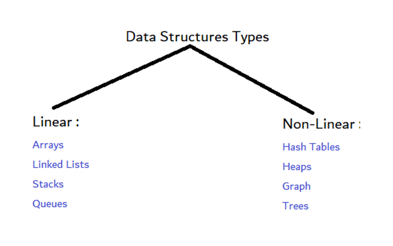
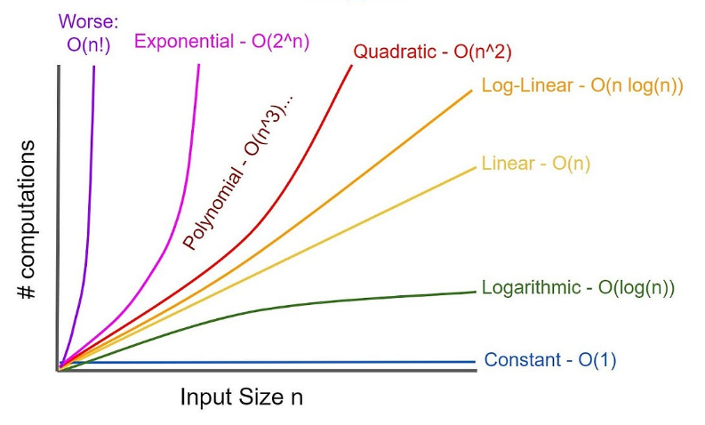
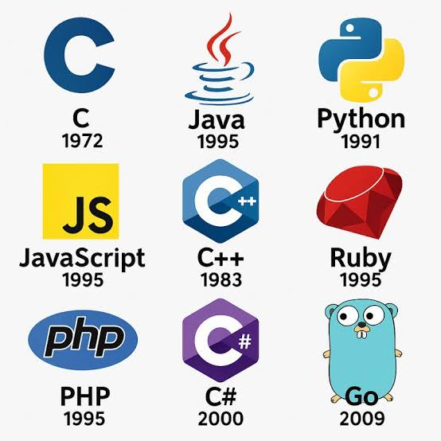
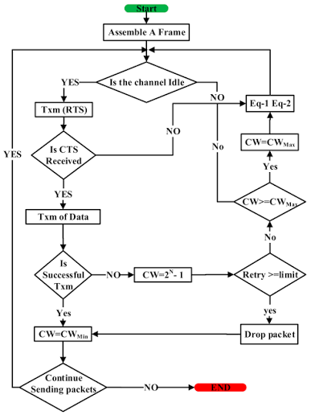

<h3 class="blog-subtitle">
هنا التدوينات كاملة
</h3>

1. [مقدمة عن هياكل البيانات](blog/ds1.qmd)

 

هياكل البيانات هي طرق تنظيم وتخزين البيانات في الحاسوب بحيث يمكن الوصول إليها لإدارتها بشكل جيد , بدون الحاجة لقاعدة بيانات خارجية وما إلى ذلك. في هذا المقال سنستعرض بعض هياكل البيانات الأساسية التي يستخدمها المبرمجون في مشاريعهم.

 

[أكمل القراءة](blog/ds1.qmd)

2. [التحليل المقارب](blog/asymptotic.qmd)

 

هو نوع من أنواع التحليل الرياضي لمعرفة مدى استمرارية الخوارزميات ووقتها لتقييم سلوكها .

 

[أكمل القراءة](blog/asymptotic.qmd)

3. [الاستدعاءات الثنائية](blog/recurrences.qmd)

 

الاستدعاء الذاتي هو عملية في عالم البرمجة والخوارزميات تقوم فيها الدالة أو الخوارزمية بإستدعاء نفسها بشكل مستمر مما يسبب مشاكلاً في سلوك البرنامج وقد يعتبر أحياناً كحل جيد لتقسيم البرنامج لأجزاء صغيرة .

 

[أكمل القراءة](blog/recurrences.qmd)

4. [أنواع لغات البرمجة](blog/languages.qmd)

 

لغة البرمجة هي لغة تستخدم لكتابة الأوامر الموجهة والمطلوب من الحاسوب تنفيذها , نستخدم في حياتنا التقنية العديد من لغات البرمجة لعدد من الإستخدامات .

 

[أكمل القراءة](blog/languages.qmd)

5. [دالة التنسيق الموزعة](blog/dcf.qmd)

 

يرجى قبل قراءة هذا المقال مراجعة مقال شبكات الحاسب في مدونتي للذكاء الاصطناعي

 

[أكمل القراءة](blog/dcf.qmd)

