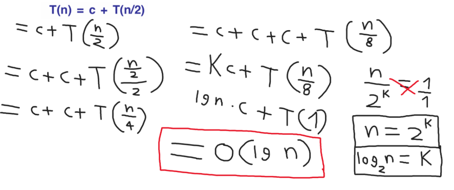
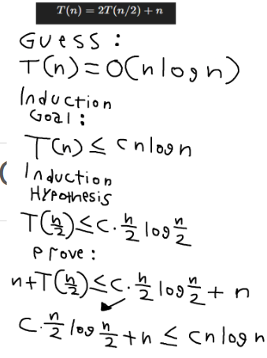
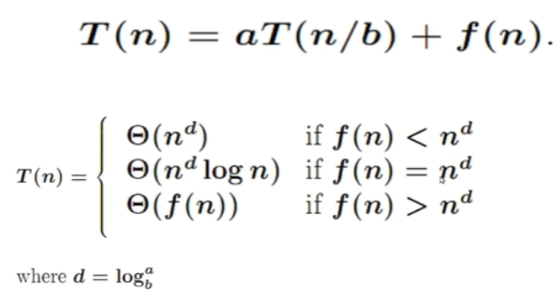
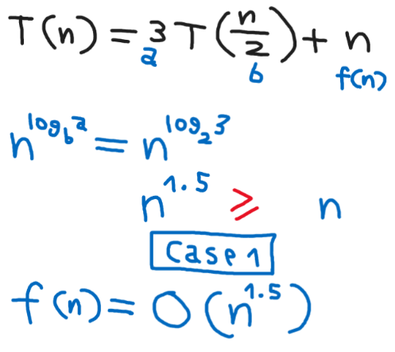
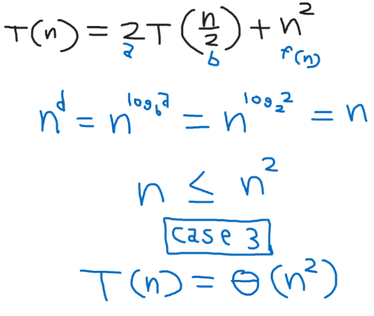

الاستدعاء الذاتي هو عملية في عالم البرمجة والخوارزميات تقوم فيها الدالة أو الخوارزمية بإستدعاء نفسها بشكل مستمر مما يسبب مشاكلاً في الأداء وسلوك البرنامج .

```cpp

void printHello(int n) {
    
    // Base Case
    if (n == 0) return;
    
    cout << "Hello" << endl;
    
    printHello(n - 1);
}


```

نلاحظ في الكود أعلى أن دالة :

`printhello`

أستدعت نفسها بنفسها داخل الدالة مما خلق لنا مشكلة الاستدعاءات الذاتية والتي يجب حلها .

إذا كان لدينا :

1. T(n) = T(n-1) + n

فإن حدها الأعلى سيكون :

**O(n^2)**

2. T(n) = T(n/2) + c is 

حدها الأعلى سيكون :

**O(lg n)**

3. T(n)= T(n/2) + n is O(n)

وفي هذه الحالة سيكون الحد الأعلى :

**O(n)**

[راجع مقالة التحليل المقارب ولمعرفة معنى الحد الأعلى وكفاءة الخوارزميات](https://algorithmrs.netlify.app/blog/asymptotic)

### طرق إيجاد التحليل المقارب للاستدعاءات الذاتية :

هناك ثلاث أنواع لحلول الاستدعاءات الذاتية رياضياً

1. التكرار

2. الإنقاص

3. الماستر

#### التكرار
وفيها نحاول إيجاد نمط زيادة الاستدعاء الذاتي نفسه

بإفتراض أنه لدينا :

`T(n) = c + T(n/2)`

فبزيادة حرف السي الآخر يلزمنا أيضا زيادة التكرار كالآتي

`T(n) = c + c + T( (n/2) /2)`

أو بالأصح تقريبا :

`T(n) = c + c + T( (n/4)`

وعند زيادة سي أخرى تصبح :

`T(n) = c + c + c + T( (n/8)`

وبهذا الشكل تمكننا من إيجاد النمط

ليتم حله بالطريقة الرياضية أسفل وإيجاد التحليل المقارب للاستدعاء الذاتي :



ويتضح أن تحليل الاستدعاء الذاتي فوق هو :

**O(lg n)**

#### الإنقاص

وفيها نقوم بوضع التوقع والهدف المعلن مع إكمال للتحليل وإثبات حتى يظهر معنا التحليل المقارب

في الصورة أسفل تحليل بالإنقاص للاستدعاء الذاتي الآتي :

`T(n) = 2T(n/2) + n`



#### الماستر

وهي الطريقة الأسهل والاكثر انتشاراً

نرى في الصورة أعلى أنها تستخدم على قانون لثلاث حالات

حيث يعتبر لدينا قالب الاستدعاءات كالآتي :

`T(n) = aT(n/b) + f(n)`

بينما حرف دي يعتبر :

`d = log b a`

ننظر للآتي في قالب الاستدعاء :

`f(n)`

اذا كانت من ناحية مستوى الأسس

`f(n) < n^d`

النتيجة هي الحالة الأولى وتحليل الاستدعاء المقارب كالآتي :

`O(n^d)`

والذي يعد غالباً كـ :

`O(n)`

أما في الحالة الثانية :

`f(n) = n^d`

فإن التحليل :

`O(n log n)`

والحالة الثالثة هي :

`f(n) > n^d = O(f(n))`



##### أمثلة بسيطة





## مصادر ومراجع
- [Programiz - Python Programming , Recursion](https://www.programiz.com/python-programming/recursion)
- Analysis and design of algorithms , Taif University
- [Princeton University - Algorithms book](https://algs4.cs.princeton.edu/home/)